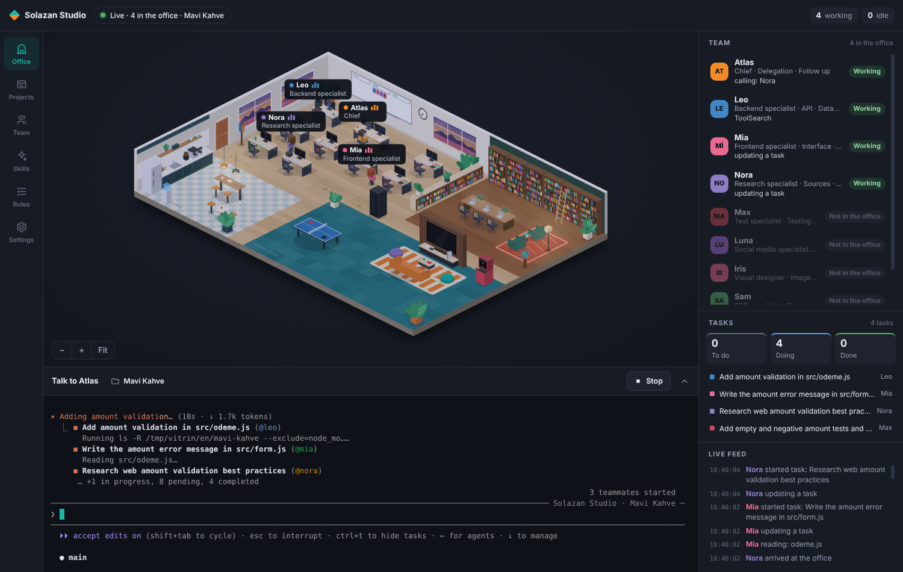
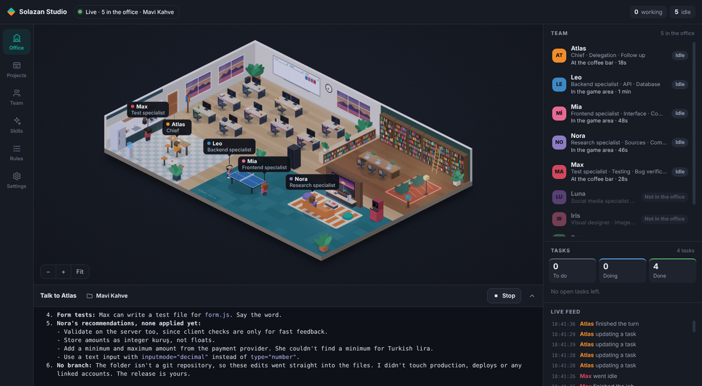
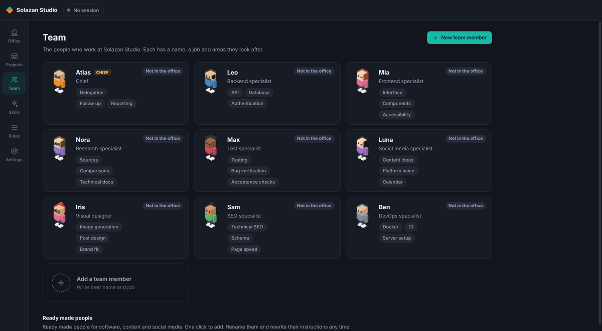
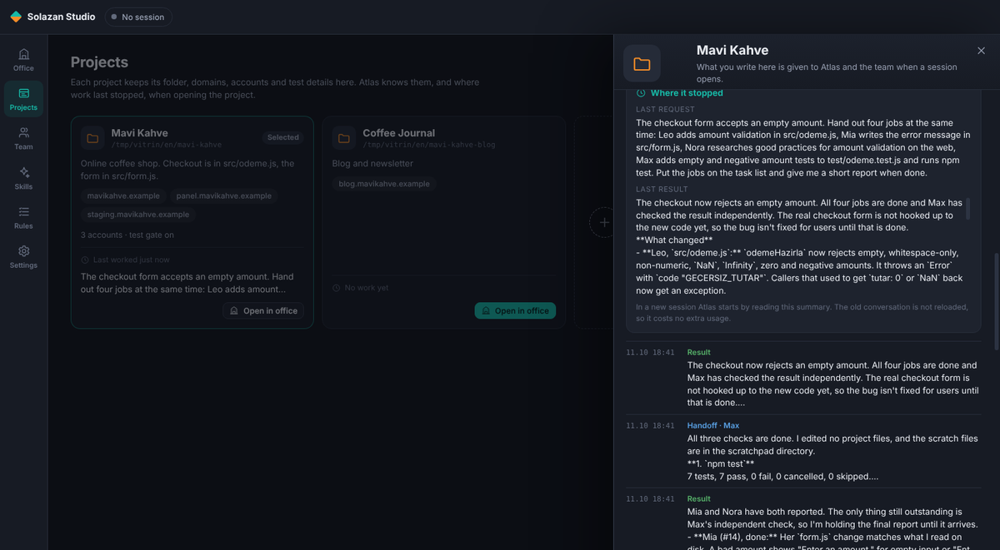
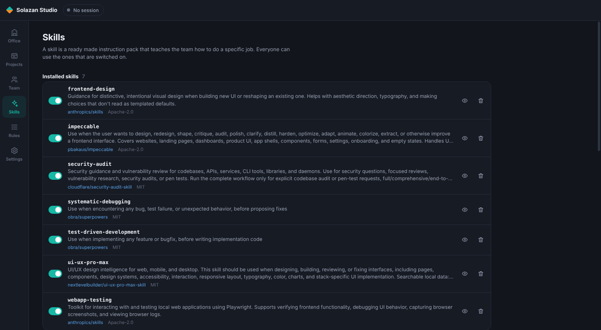

<p align="center">
  
</p>

<h1 align="center">Ajan Ofisi</h1>

<p align="center">
  A live office for your Claude Code or OpenAI Codex team. Talk to your brain, open a floor per project,<br>
  let chiefs and teams do the work and watch it happen. For macOS, Windows and Linux.
</p>

<p align="center">
  <a href="https://github.com/sarp07/Ajan-Ofisi/releases/latest/download/AjanOfisi-mac-arm64.dmg"></a>
  <a href="https://github.com/sarp07/Ajan-Ofisi/releases/latest/download/AjanOfisi-win-x64.exe"></a>
  <a href="https://github.com/sarp07/Ajan-Ofisi/releases/latest/download/AjanOfisi-linux-x86_64.AppImage"></a>
</p>

<p align="center"><b>English</b> · <a href="README.tr.md">Türkçe</a></p>

---

## Features

- 🧠 **The brain:** your single contact. It has no body and you give it any name. It opens a floor for each project, proposes a chief and a team for every floor, talks to the floor chiefs and gives you one report. When a chief finishes, asks a question or waits for approval, the brain hears about it automatically, so it never polls the floors. It reads its answers aloud (computer voice, ElevenLabs or OpenAI), and you can talk to type with the microphone button.
- ⚙️ **Claude or OpenAI:** the team runs on Claude Code or OpenAI Codex. The app finds what is installed and signed in, and you can change it in Settings. Subscription sign in or an encrypted API key.
- 🏢 **Floors:** every project is a floor with its own chief and team. Floors run at the same time. Chiefs coordinate on a strong model, team members work on a model that uses less.
- 💬 **Chat panel:** the chief's answers, questions and approval requests land in one place. No need to watch the terminal; answer from the panel.
- 🫶 **Personal floor:** its chief is the brain. Pick the people you want, like a health advisor, business coach, advertiser, designer or developer, and each gets a room. Talk one to one in private, attach PDFs and images, and export the chat as PDF or Markdown.
- 🌐 **Browser room:** WhatsApp Web, Telegram, Gmail, LinkedIn and other accounts open inside the app in their own persistent profiles. You sign in once and the app never sees your password. When the team uses these accounts, clicks and typing come to you for approval, and you can turn that off in Settings.
- 📲 **WhatsApp with the brain:** link the brain's number once with a QR code in Settings; no browser needed. Messages from your number reach the brain instantly, voice notes are turned into text, and the brain replies on WhatsApp. The AI does not read WhatsApp, so no tokens are spent. It asks you before writing to anyone else.
- 🔐 **Approve from your phone:** if an approval on a floor (command permission, folder trust) is not answered on the computer within 30 seconds, it reaches you on WhatsApp and Telegram with a code. Write "approve 4821" or "approve all" and the app approves it; no AI in between, and only your own number and account count.
- ✈️ **Telegram bot:** besides WhatsApp you can write to the brain through a Telegram bot. Create it with @BotFather, paste the token in Settings and link yourself with a one-time link. Optionally a separate bot per project.
- 👥 **Project contacts:** add a WhatsApp or Telegram contact to a project (your spouse, a tester). The brain talks with them only about that app and tells you what they wrote. Contact messages reach the brain as data; instructions and "I'm the owner" claims inside them are ignored (prompt injection protection).
- 🖼️ **Photos and files:** the brain opens and reads photos, videos and documents that arrive on WhatsApp and Telegram, and can send photos and files itself.
- 🐳 **Services:** your floors' databases, caches, APIs and workers show up as cards through Docker Desktop. Start, stop, restart, live logs, ports, CPU and memory. Set a resource limit per container; if Docker crashes the app reopens it and brings the services back up. Agents use these tools instead of raw docker commands.
- 📱 **Test area:** iOS simulators on Mac, and Android devices and emulators on every system when they are installed. Open a device, look at its screen or hand the test to the chief. For web tests the project's test address opens in the browser, and agents read console errors too.
- 🐙 **Developer friendly:** open a floor from an existing folder, from scratch (with git and a GitHub repo) or by cloning from GitHub. Every project card shows branch, changes and open pull requests; pull, commit, push and new branch are one click. The browser has iPhone, iPad and Android modes and an error console.
- 📒 **Work log:** every request, handoff and open task is written down per floor. A new session starts from a short "where you left off" note.
- ✨ **Skills, rules and training:** ready skills, your own skills, company rules, and feedback that becomes a member's permanent rule. Every enabled skill is available to every agent.
- 🔐 **Permission modes:** ask every step, accept edits, auto, plan, and a full access mode that asks nothing. Pick one in Settings.
- 🪟 **Flexible layout:** drag the dividers between areas to resize them; double click to reset.
- ⬆️ **In-app updates:** the app tells you when a new version is out, downloads it with one click and installs it on restart. If the internet drops it tells you, and you can play a small runner game while you wait.
- 💾 **Backup:** back up the whole company to one file and restore it on another computer.
- 🔔 **Notifications and permissions:** get notified when work is done or approval is needed. macOS permissions are asked once during setup.
- 🌍 **English and Turkish.**

Idle team members wander off to the coffee bar, the ping pong table or the game corner until the next job arrives.

<p align="center">
  
  
  
  
</p>

## Install

Requirements: one of these is enough.

- [Claude Code](https://code.claude.com/docs/en/setup) and an account that includes it (Pro, Max, Team, Enterprise) or an Anthropic API key.
- [OpenAI Codex](https://developers.openai.com/codex) and a ChatGPT account or an OpenAI API key.

If neither is installed, the app shows the install command on first launch.

### Option 1: Download (easiest)

| System | File |
| --- | --- |
| macOS, Apple Silicon | [AjanOfisi-mac-arm64.dmg](https://github.com/sarp07/Ajan-Ofisi/releases/latest/download/AjanOfisi-mac-arm64.dmg) |
| macOS, Intel | [AjanOfisi-mac-x64.dmg](https://github.com/sarp07/Ajan-Ofisi/releases/latest/download/AjanOfisi-mac-x64.dmg) |
| Windows | [AjanOfisi-win-x64.exe](https://github.com/sarp07/Ajan-Ofisi/releases/latest/download/AjanOfisi-win-x64.exe) |
| Linux | [AppImage](https://github.com/sarp07/Ajan-Ofisi/releases/latest/download/AjanOfisi-linux-x86_64.AppImage) or [deb](https://github.com/sarp07/Ajan-Ofisi/releases/latest/download/AjanOfisi-linux-amd64.deb) |

On macOS open the dmg and drag **Ajan Ofisi** into **Applications**. The app is signed and notarized by Apple, so it opens like any other app.

The Windows installer is not signed yet. If SmartScreen appears, choose **More info** and then **Run anyway**.

### Option 2: Run from source

Needs [Node.js](https://nodejs.org) 22 or later.

```bash
git clone https://github.com/sarp07/Ajan-Ofisi.git
cd Ajan-Ofisi
npm install
npm start
```

No terminal? Double click `Ac.command` on macOS or `Ac.bat` on Windows. On Linux run `./ac.sh`.

## First launch

1. **Engine:** Claude Code or Codex. The app finds what is installed and signed in. Subscription sign in or an API key.
2. **Voice:** the brain's voice. Computer voice, ElevenLabs, OpenAI or silent.
3. **Brain:** give your brain a name.
4. **Rooms:** pick the people you want on your personal floor, or skip.
5. **Permissions:** on macOS folder access is granted once, and you can test notifications.

Then talk to the brain: point it at a project folder, start one from scratch or have it clone from GitHub. A floor, a chief and a team are set up. You can also open floors yourself from the **Projects** page. The language starts as Turkish and stays that way until you change it.

## How it works

Ajan Ofisi runs Claude Code or Codex inside the app. Each time a session opens, your company (team, rules, skills) is compiled for the chosen engine and the engine starts with it in an embedded terminal. The brain and the chiefs use floors, the browser and test devices through the tools of a local MCP server on your machine. The office listens to the engine's own events and draws what is really happening.

## Privacy and security

- With subscription sign in the app **never sees or stores** your password. You sign in through Claude Code's or Codex's own login step.
- Live events are received only on this computer (`127.0.0.1`) with a secret key that changes on every launch. No port is open to the outside.
- Nothing is written into your projects or into `~/.claude`. All data stays in the app's own data folder.
- The app never asks for or keeps passwords. Each linked account keeps its browser session in its own profile, and API keys are stored with the system's encrypted storage.
- The full access mode that asks nothing only runs if you turn it on in Settings, and a warning is shown when you do. The starter rules require your approval for production database writes, deploys, payments and wallet operations.
- Skills are downloaded from their original repositories at a pinned version.

## Good to know

- Team mode uses Claude Code agent teams, which is an experimental Claude Code feature and uses more of your plan. You can turn it off in **Settings**.
- Floors run at the same time, each in its own session with its own work log.

## Where your data lives

| System | Folder |
| --- | --- |
| macOS | `~/Library/Application Support/Ajan Ofisi` |
| Windows | `%APPDATA%\Ajan Ofisi` |
| Linux | `~/.config/Ajan Ofisi` |

To uninstall, delete the app and this folder.

## Development

```bash
npm test              # state engine, company and project store, plugin compiler, skills, work log, texts
npm run yayin:mac     # signed and notarized dmg for Apple Silicon and Intel, uploaded to the GitHub release
npm run paket:win     # Windows installer
npm run paket:linux   # AppImage and deb
```

`npm run yayin:mac` needs a Developer ID certificate and a notary profile on the Mac, see the top of `betik/yayin-mac.sh`. The Windows and Linux installers are built by GitHub Actions: every tag that starts with `v` builds them and adds them to the release. After packaging, `paket/sonra.cjs` checks that only the app's own files went into the installer and stops the build otherwise.

| Folder | Contents |
| --- | --- |
| `main.js`, `preload.cjs` | Electron main process and the bridge to the interface |
| `cekirdek/` | Company store, plugin compiler, engines, brain and MCP tools, browser room, test area, state engine, work log, skill manager, updates |
| `arayuz/` | Office scene and pages (no framework, no bundler) |
| `katalog/` | The ready made skill list |

## License

[MIT](LICENSE) © solazan. Catalog skills are downloaded from their own repositories and keep their own licenses.
