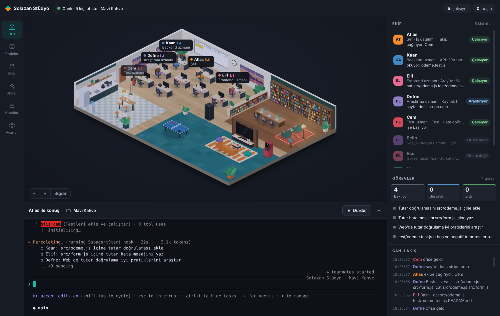
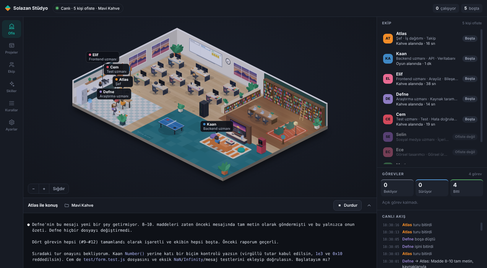
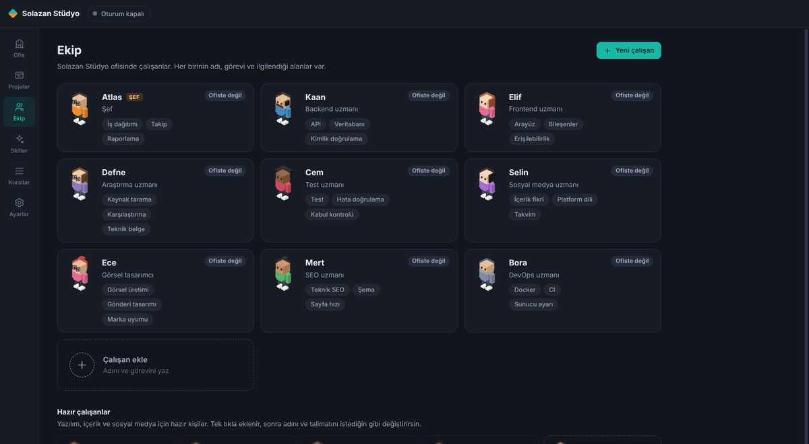
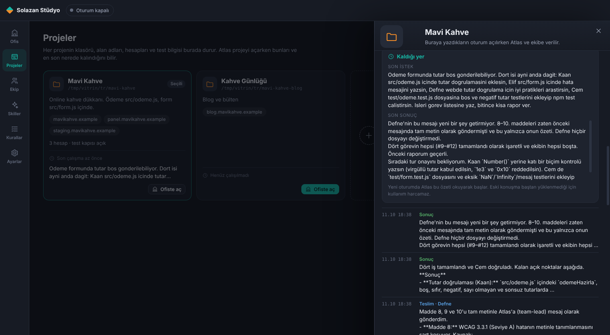
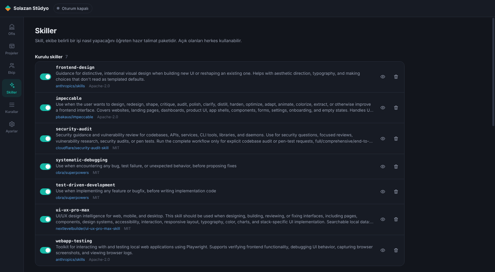

<p align="center">
  
</p>

<h1 align="center">Ajan Ofisi</h1>

<p align="center">
  Claude Code ya da OpenAI Codex ekibin için canlı bir ofis. Beyninle konuş, projelerine kat aç,<br>
  şefler ve ekipler işi yapsın, sen izle. macOS, Windows ve Linux için.
</p>

<p align="center">
  <a href="https://github.com/sarp07/Ajan-Ofisi/releases/latest/download/AjanOfisi-mac-arm64.dmg"></a>
  <a href="https://github.com/sarp07/Ajan-Ofisi/releases/latest/download/AjanOfisi-win-x64.exe"></a>
  <a href="https://github.com/sarp07/Ajan-Ofisi/releases/latest/download/AjanOfisi-linux-x86_64.AppImage"></a>
</p>

<p align="center"><a href="README.md">English</a> · <b>Türkçe</b></p>

---

## Özellikler

- 🧠 **Beyin:** tek muhatabın. Bedeni yok, ona istediğin adı verirsin. Projelerin için katlar açar, her kata bir şef ve ekip önerir, kat şefleriyle konuşur ve sana tek bir rapor verir. Şef işi bitirince, soru sorunca ya da onay bekleyince beyne kendiliğinden haber gider, beyin katları yoklamaz. Cevaplarını sesli okur (bilgisayar sesi, ElevenLabs ya da OpenAI), sen de mikrofon düğmesiyle konuşarak yazarsın.
- ⚙️ **Claude ya da OpenAI:** ekip Claude Code ya da OpenAI Codex ile çalışır. Uygulama kurulu ve giriş yapılmış olanı kendisi bulur, istersen Ayarlar'dan değiştirirsin. Abonelikle giriş ya da şifreli saklanan API anahtarı.
- 🏙️ **Bina:** ofis gece şehrinde yüksek bir cam kule. Aktif kat yerinde durur, üst katlar yukarı ayrılır; açık katların ışıkları yanar. Asansörle ya da kata tıklayarak geçersin.
- 📚 **Çok depolu kat:** proje monorepo değilse api, web, admin gibi ayrı depolar aynı kata eklenir; ekip hepsinde çalışır, Git paneli her depo için ayrı sekme açar.
- 🏢 **Katlar:** her proje bir kat, her katın kendi şefi ve ekibi var. Katlar aynı anda çalışır. Kat şefleri güçlü modelle yönetir, çalışanlar daha az harcayan modelle iş yapar.
- 💬 **Konuşma paneli:** şefin cevapları, sana sorduğu sorular ve onay istekleri tek yerde toplanır. Terminali takip etmen gerekmez, cevabını panelden yazarsın.
- 🫶 **Kişisel kat:** şefi beyindir. Sağlık danışmanı, iş koçu, reklamcı, tasarımcı, yazılımcı gibi istediğin kişileri seçersin, her birinin ayrı odası olur. Odalarda bire bir, özel konuşursun. PDF ve resim eklersin, konuşmayı PDF ya da Markdown olarak indirirsin.
- 🌐 **Tarayıcı odası:** WhatsApp Web, Telegram, Gmail, LinkedIn ve diğer hesapların uygulamanın içinde kendi kalıcı profillerinde açılır. Girişi bir kez sen yaparsın, şifreni uygulama görmez. Ekip bu hesapları kullanırken tıklama ve yazma senin onayına gelir, istersen Ayarlar'dan kapatırsın.
- 📲 **WhatsApp ile beyin:** beynin numarası Ayarlar'dan bir kez QR ile bağlanır, tarayıcı gerekmez. Senin numarandan gelen mesaj anında beyne düşer, sesli mesajlar yazıya çevrilir, beyin cevabını WhatsApp'tan yazar. Yapay zekâ WhatsApp'ı okumaz, jeton harcanmaz. Başkasına yazmadan önce senden onay alır.
- 🔐 **Telefondan onay:** katta bekleyen bir onay (komut izni, klasör güveni) 30 saniye içinde bilgisayardan cevaplanmazsa WhatsApp ve Telegram'a kodla gelir. "onay 4821" ya da "hepsini onayla" yazınca onayı uygulama verir; yapay zekâ araya girmez, yalnızca senin numaran ve hesabın geçerlidir.
- ✈️ **Telegram botu:** WhatsApp'ın yanında beyne Telegram botundan da yazarsın. Botu @BotFather'dan açıp belirteci Ayarlar'a yapıştırırsın, kendini tek kullanımlık bir adresle bağlarsın. İstersen her projeye ayrı bot.
- 👥 **Proje kişileri:** bir projeye WhatsApp ya da Telegram kişisi eklersin (eşin, bir testçi). Beyin onunla yalnızca o uygulama hakkında konuşur, ne yazdığını sana iletir. Kişi mesajları beyne veri olarak gider; içindeki talimatlar ve "ben sahibim" iddiaları dikkate alınmaz (prompt injection koruması).
- 🖼️ **Fotoğraf ve dosya:** WhatsApp ve Telegram'dan gelen fotoğraf, video ve belgeleri beyin açıp okur; beyin de fotoğraf ve dosya gönderebilir.
- 🐳 **Servisler:** katların veritabanı, önbellek, API ve worker servisleri Docker Desktop üzerinden kart olarak görünür. Başlat, durdur, yeniden başlat, canlı log, port, CPU ve bellek. Kap başına kaynak sınırı konur, Docker çökerse uygulama onu yeniden açıp servisleri kaldırır. Ajanlar ham docker komutu yerine bu araçları kullanır.
- 🔐 **Proje bazlı ortam değişkenleri:** her repo kökü ve monorepo paketi (apps/web, apps/api …) ayrı bir birimdir; workspace ve `.env.example` dosyalarından kendiliğinden bulunur. Değerler şifreli durur ve yalnızca ilgili klasörün `.env` ya da `.env.local` dosyasına (çatıya göre) yazılır, git dışında tutulur. `DATABASE_URL`, `PORT` ve `API_URL` gibi birimler arası adresler ortak veritabanına ve katın portlarına kendiliğinden bağlanır. Eksikler kırmızı görünür, var olan `.env` dosyaları içe aktarılır, ayrı `.env.test` profili vardır; ajanlar araçlarla yönetir ama gizli değerleri görmez.
- 🧰 **Hazır skill takımı:** önerilen skiller ilk bağlantıda kendiliğinden kurulur: yazım ve metin, SEO ve metadata, web kalitesi, mobil test (Maestro, XCUITest, Detox), App Store ve Google Play sayfası, Playwright web ve API testleri, Remotion video, tasarım ve güvenlik.
- 🗄️ **Ortak Postgres ve portlar:** bilgisayarda tek bir Postgres çalışır, her proje içinde kendi veritabanını ve kullanıcısını alır (projeler birbirinin verisine erişemez). 5432 doluysa çakışmayan bir port seçilir. Her kata kalıcı, çakışmayan bir port bloğu verilir; ajanlar yeni Postgres kurmaz, sabit port seçmez.
- 📱 **Simülatör:** cihaz ekranı uygulamanın içinde canlı çalışır. Tıklayınca dokunur, sürükleyince kaydırır; metin yazar, Ana ekran ve Kilit tuşlarına basar, kurulu uygulamaları başlatırsın. Ajanlar aynı cihazı araçlarla kullanır (ekrandaki öğeleri listeler, dokunur, kaydırır, yazar, kurulu uygulamayı açar); mobil test Safari yerine uygulamanın kendisini açar. Mac'te iOS simülatörleri, kurulu olduğunda her sistemde Android cihaz ve emülatörleri. Aynı anda tek simülatör önerilir; fazlası açıksa uyarı çıkar. Web testleri için projenin test adresi tarayıcıda açılır, ajanlar konsol hatalarını da okur.
- 🐙 **GitHub yönetimi:** proje kartından dalları birleştir ya da sil (main ve varsayılan dal korunur), PR aç, birleştir, kapat; depoyu gizli/açık yap, arşivle, adını değiştir ya da deponun tam adını yazarak sil. Ajanlar aynı işleri kendi araçlarıyla yapar; PR birleştirme ve depo ayarı senin onayına gelir.
- 🔓 **Daha az onay:** varsayılan izin modu "otomatik karar ver": okuma, test ve yerel kontroller sorulmaz, yalnızca riskli işler sorulur.
- 🐙 **Geliştirici dostu:** yeni katı var olan klasörden, sıfırdan (git ve GitHub reposuyla) ya da GitHub'dan klonlayarak açarsın. Her proje kartında dal, değişiklik, açık PR'lar; pull, commit, push ve yeni dal tek tık. Tarayıcıda iPhone, iPad, Android modları ve hata konsolu.
- 📒 **Kayıt defteri:** her katta ne istendiği, kimin ne teslim ettiği ve hangi görevin açık kaldığı yazılır. Yeni oturum kısa bir "kaldığın yer" notuyla başlar.
- ✨ **Skiller, kurallar ve eğitim:** hazır skiller, kendi skillerin, şirket kuralları ve çalışana verdiğin geri bildirimin kalıcı kurala dönüşmesi. Açık olan bütün skiller her ajanın kullanımındadır.
- 🔐 **İzin modları:** her adımı soran, düzenlemeleri kendisi kabul eden, otomatik, plan ve hiçbir şey sormayan tam yetki modu. Ayarlar'dan seçersin.
- 🪟 **Esnek düzen:** bölümlerin arasındaki çizgileri sürükleyerek boyutlandırırsın, çift tıklayınca varsayılana döner.
- ⬆️ **Uygulama içi güncelleme:** yeni sürüm çıkınca uygulama haber verir, tek tıkla indirip yeniden başlatınca kurar. İnternet koparsa haber verir, beklerken küçük bir koşu oyunu oynarsın.
- 💾 **Yedek:** şirketin tamamını tek dosyaya yedekler, başka bilgisayarda geri yüklersin.
- 🔔 **Bildirimler ve izinler:** iş bitince ya da onay gerekince bildirim gelir. macOS izinleri ilk açılışta tek adımda istenir.
- 🌍 **Türkçe ve İngilizce.**

İşi olmayan çalışanlar yeni iş gelene kadar kahve köşesine, masa tenisine ya da oyun alanına gider.

<p align="center">
  
  
  
  
</p>

## Kurulum

Gereksinimler: şunlardan biri yeterli.

- [Claude Code](https://code.claude.com/docs/en/setup) ve Claude Code içeren bir hesap (Pro, Max, Team, Enterprise) ya da Anthropic API anahtarı.
- [OpenAI Codex](https://developers.openai.com/codex) ve ChatGPT hesabı ya da OpenAI API anahtarı.

Hiçbiri kurulu değilse uygulama ilk açılışta kurulum komutunu gösterir.

### Yöntem 1: İndir (en kolayı)

| Sistem | Dosya |
| --- | --- |
| macOS, Apple Silicon | [AjanOfisi-mac-arm64.dmg](https://github.com/sarp07/Ajan-Ofisi/releases/latest/download/AjanOfisi-mac-arm64.dmg) |
| macOS, Intel | [AjanOfisi-mac-x64.dmg](https://github.com/sarp07/Ajan-Ofisi/releases/latest/download/AjanOfisi-mac-x64.dmg) |
| Windows | [AjanOfisi-win-x64.exe](https://github.com/sarp07/Ajan-Ofisi/releases/latest/download/AjanOfisi-win-x64.exe) |
| Linux | [AppImage](https://github.com/sarp07/Ajan-Ofisi/releases/latest/download/AjanOfisi-linux-x86_64.AppImage) ya da [deb](https://github.com/sarp07/Ajan-Ofisi/releases/latest/download/AjanOfisi-linux-amd64.deb) |

macOS'ta dmg dosyasını aç ve **Ajan Ofisi** uygulamasını **Uygulamalar** klasörüne sürükle. Uygulama Apple tarafından imzalanmış ve onaylanmıştır (notarized), diğer uygulamalar gibi doğrudan açılır.

Windows kurulum dosyası henüz imzalı değil. SmartScreen uyarısı çıkarsa **Ek bilgi** ve ardından **Yine de çalıştır** seç.

### Yöntem 2: Kaynak koddan çalıştır

[Node.js](https://nodejs.org) 22 ya da üstü gerekir.

```bash
git clone https://github.com/sarp07/Ajan-Ofisi.git
cd Ajan-Ofisi
npm install
npm start
```

Terminal kullanmak istemiyorsan macOS'ta `Ac.command`, Windows'ta `Ac.bat` dosyasına çift tıkla. Linux'ta `./ac.sh` yaz.

## İlk açılış

1. **Motor:** Claude Code ya da Codex. Uygulama kurulu ve giriş yapılmış olanı kendisi bulur. Abonelikle giriş ya da API anahtarı.
2. **Ses:** beynin sesi. Bilgisayar sesi, ElevenLabs, OpenAI ya da sessiz.
3. **Beyin:** beynine isim ver.
4. **Odalar:** kişisel katta olmasını istediğin kişileri seç ya da geç.
5. **İzinler:** macOS'ta klasör izinleri tek seferde verilir, bildirimleri denersin.

Sonra beyinle konuş: proje klasörünü göster, sıfırdan aç ya da GitHub'dan klonlat. Kat, şef ve ekip kurulur. Kat açmayı **Projeler** sayfasından kendin de yapabilirsin. Dil başta Türkçedir, değiştirmediğin sürece Türkçe kalır.

## Nasıl çalışır

Ajan Ofisi, Claude Code ya da Codex'i uygulamanın içinde çalıştırır. Her oturum açılışında şirketin (ekip, kurallar, skiller) motora uygun biçimde derlenir ve motor gömülü terminalde bununla başlar. Beyin ve şefler katları, tarayıcıyı ve test cihazlarını bu bilgisayardaki yerel bir MCP sunucusunun araçlarıyla kullanır. Ofis, motorun kendi olaylarını dinler ve gerçekte ne oluyorsa onu çizer.

## Gizlilik ve güvenlik

- Abonelikle girişte uygulama şifreni **görmez ve saklamaz**. Giriş, Claude Code'un ya da Codex'in kendi giriş adımıyla yapılır.
- Canlı olaylar yalnızca bu bilgisayarda (`127.0.0.1`), her açılışta değişen gizli bir anahtarla alınır. Dışarıya açık kapı yoktur.
- Projelerine ve `~/.claude` klasörüne hiçbir şey yazılmaz. Bütün veri uygulamanın kendi veri klasöründe durur.
- Uygulama şifre istemez ve tutmaz. Her bağlı hesabın tarayıcı oturumu kendi profilinde durur, API anahtarları sistemin şifreli deposunda saklanır.
- Hiçbir şey sormayan tam yetki modu yalnızca sen Ayarlar'dan açarsan çalışır ve açarken uyarı gösterilir. Başlangıç kuralları canlı veritabanına yazmayı, yayına almayı, ödeme ve cüzdan işlemlerini senin onayına bağlar.
- Skiller kendi depolarından, sabit bir sürüme bağlı olarak indirilir.

## Bilmen gerekenler

- Takım modu Claude Code'un ajan takımlarını kullanır. Bu, Claude Code tarafında deneysel bir özelliktir ve daha çok kullanım harcar. **Ayarlar** sayfasından kapatabilirsin.
- Katlar aynı anda çalışır. Her katın kendi oturumu ve kayıt defteri vardır.

## Verin nerede durur

| Sistem | Klasör |
| --- | --- |
| macOS | `~/Library/Application Support/Ajan Ofisi` |
| Windows | `%APPDATA%\Ajan Ofisi` |
| Linux | `~/.config/Ajan Ofisi` |

Kaldırmak için uygulamayı ve bu klasörü sil.

## Geliştirme

```bash
npm test              # durum motoru, şirket ve proje deposu, eklenti derleyici, skiller, kayıt defteri, metinler
npm run yayin:mac     # Apple Silicon ve Intel için imzalı, Apple onaylı dmg; GitHub sürümüne yükler
npm run paket:win     # Windows kurulum dosyası
npm run paket:linux   # AppImage ve deb
```

`npm run yayin:mac` için Mac'te Developer ID sertifikası ve onay profili gerekir, ayrıntı `betik/yayin-mac.sh` dosyasının başında. Windows ve Linux kurulum dosyalarını GitHub Actions üretir: `v` ile başlayan her etikette ikisi de üretilip sürüme eklenir. Paketlemeden sonra `paket/sonra.cjs`, kurulum dosyasına yalnızca uygulamanın kendi dosyalarının girdiğini denetler, fazlası varsa derlemeyi durdurur.

| Klasör | İçerik |
| --- | --- |
| `main.js`, `preload.cjs` | Electron ana süreci ve arayüz köprüsü |
| `cekirdek/` | Şirket deposu, eklenti derleyici, motorlar, beyin ve MCP araçları, tarayıcı odası, test alanı, durum motoru, kayıt defteri, skill yöneticisi, güncelleme |
| `arayuz/` | Ofis sahnesi ve sayfalar (çatı ya da paketleyici yok) |
| `katalog/` | Hazır skill listesi |

## Lisans

[MIT](LICENSE) © solazan. Katalogdaki skiller kendi depolarından indirilir ve kendi lisanslarına tabidir. Mac uygulaması simülatör girdisi ve canlı görüntü için [AXe](https://github.com/cameroncooke/AXe)'yi (MIT) içinde taşır; lisansı yanında gelir.
